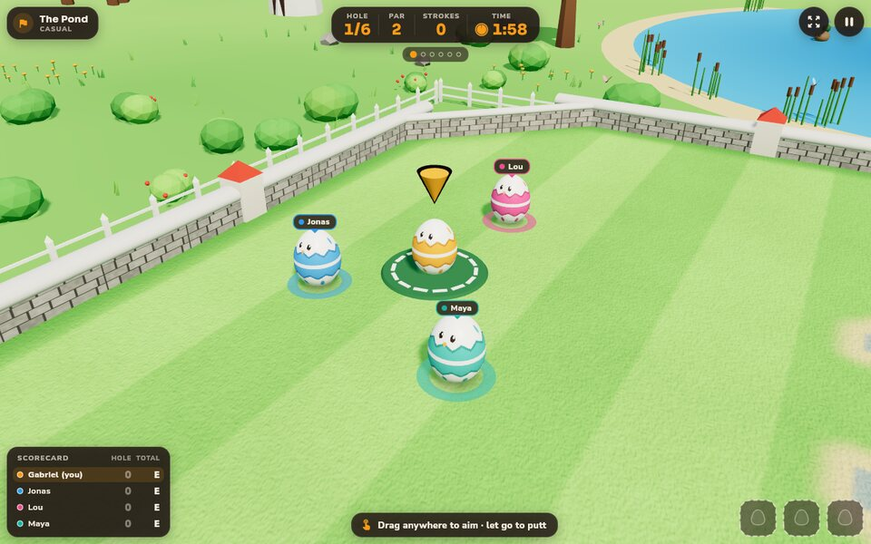
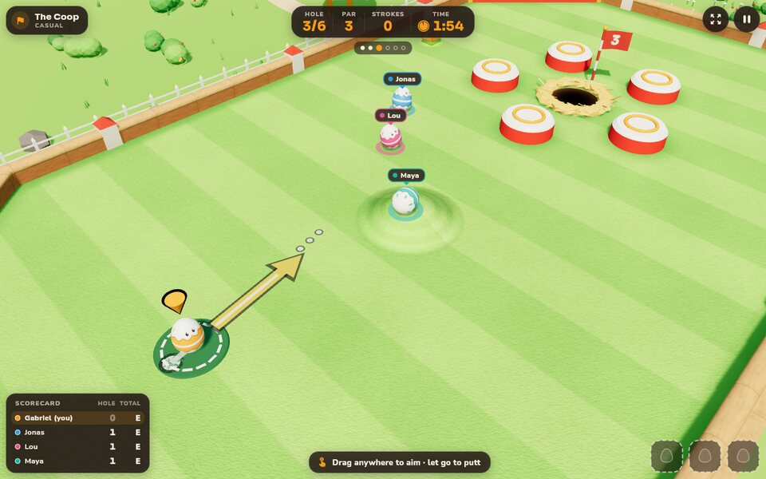
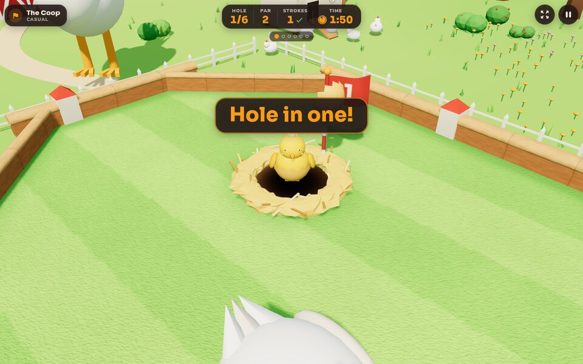
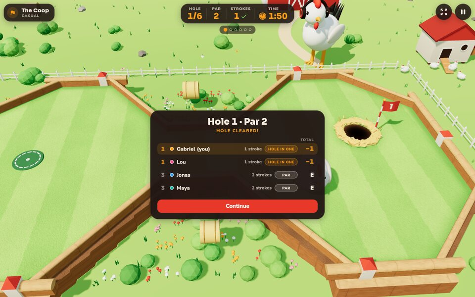

# Sunny Side Putt

The first call activity: a minigolf whose balls are EGGS and whose
holes are NESTS, on a farm, with power-ups. Inspired by Discord's Putt
Party — the numbers follow it; the identity is the Rooster's own.

In play:

A short gameplay clip (the coach, the aim, the roll, the hatch, the
results):

[putt-sunny-side-putt-3d.mp4](images/sunny-side-putt/putt-sunny-side-putt-3d.mp4)

## The game

- A course is 6 holes; a match seats 1-8 players (the ninth onward
  watches from the fence). Strokes are simultaneous: everyone lines up
  their putt when they like, and the hole ends when every egg is in or
  the 2-minute clock runs out (warning sounds on the last fifteen
  seconds).
- Out of time: the hole scores max(strokes taken, par + 2). Putt
  Party's exact rule is not documented anywhere we could verify; this
  is ours, and it punishes stalling without ending a comeback.
- Aiming is a slingshot drag; the arrow sways a little (about 3
  degrees either side) and the putt goes exactly where the arrow points
  at release, so the timing of the release is the skill; the engine adds
  no hidden error. The Hawk Eye power-up holds the arrow still.
- Mid-join: entering now puts you on the current hole's tee; the holes
  you missed score par.

### Modes

- **Casual** - one course, then the group votes the next.
- **Tournament** - 3, 6 or 9 drawn courses; the scores add up and
  power-ups travel with you.
- **Barnyard Chaos** - casual, but everyone starts with two random
  power-ups and the mystery boxes come doubled.

### Power-ups

Earned at the "?" boxes (a maximum of 3 in hand; extras discarded), and
**the one who casts never suffers their own bad effects** - the wind
spares their egg, the sprinkler waters around it.

| Power-up | Does |
|---|---|
| Hawk Eye | removes the aim wobble on your next shot |
| Nest Magnet | the egg is drawn home when it nears the nest |
| Ghost Egg | passes through fences and obstacles briefly |
| Chicken Hop | your next putt flies over whatever is in the way |
| Rabbit Hole | teleports your egg a short way, costing no stroke |
| Gust | a wind of your choosing pushes every egg but yours |
| Thick Shell | shield: the next negative effect bounces off |
| Strong Coffee | your next shot leaves 30% harder |
| Nest Swap | trade places with a chosen player's egg |
| Sprinkler | mark a spot; nearby eggs are pushed away |
| Corn Rain | kernels bounce around, nudging every egg but yours |
| Thieving Crow | steal a power-up from a chosen player |

Using one: a tap on its slot casts the ones that need nothing. One that
acts on a spot (Rabbit Hole, Gust, Sprinkler) waits for it: the slot
glows, the green shows what it would reach (the hop's range and landing,
the spray and the eggs it soaks, the pull on every other egg), and the
next press on the green casts it there; Esc, a right click, pausing or
the slot tapped again puts it away. One that acts on a player (Nest
Swap, Thieving Crow) opens a list of the players it can reach, and says
so when nobody can be picked. Nothing is spent on a cancel, or on a cast
that could do nothing (no other egg to push, my egg already in the
nest). The targeting lives in `putt_targeting.dart`, the reticle in
`putt_reticle.dart`.

### Courses

Five launch courses, six holes each, themselves teaching their
gimmicks: the Coop (a hen walks the floor and bumps eggs), the Corn
Maze (rabbit holes as speed-preserving portals), the Pond (water
returns the egg, stroke charged), Farm Road (speed strips) and the
Barn (hay bales, the silo's pull).

Hills (see below) shape eleven of the thirty holes:

- **The Coop**: a hump of packed earth across Pop Hole's far lane
  guards the nest from the safe road (the tunnel's line passes it by),
  and a dust-bath mound on Pinball Parlor's straight line throws a putt
  aimed at the crown off its line.
- **Corn Maze**: First Furrow's spur is dug into a trough that steers a
  straight putt into the rabbit hole, and Crossroads' garden dips round
  the nest, gathering an egg out of the rabbit hole that is a little
  short or long.
- **The Pond**: the Weir's far bank dishes gently down to the nest, Duck
  Walk's nest sits on a green raised at the end of the causeway, and
  Frog Pond's island rises to its nest.
- **Farm Road**: a speed bump on the Roundabout's road out turns back an
  egg that leaves the ring short of pace, and two more stand in Home
  Stretch's top lane before the farm gate.
- **The Barn**: a ridge crosses Hay Bale Pinball's floor between the
  rubber bumpers, and Threshing Floor's nest sits up in the hayloft.

### Hills

A hole can carry hills (`Hill` in `core/hole.dart`): mounds, ridges,
dips and troughs, round a point or along a line, with a flat top for a
plateau. The profile is `height * (1 - u^2)^2` across the slope, level
at both edges, so there is never a kink. The physics stays planar: an
egg feels `slopeGravity` (24) times the grade downhill. A pull stronger
than the rolling friction (7) rolls an under-hit egg back down; a
ridge has to be putted over with pace; a dip gathers eggs toward its
bottom. An egg pressed into a rail by a slope settles there instead of
rattling. Since there is no height in the physics, a hill's reach must
stay clear of walls, water, the tee and the nest's rim, unless its
plateau carries the nest. The course test checks every hill for this:
0.3 units off every rail, rock, pond, speed strip, rabbit hole, "?"
box, silo and spawn spot, and the nest either half a unit past the
skirt or on the plateau with 0.6 units of flat round its rim. A
reference putt up to a raised nest passes the climb to the course
kit's `putt` as `rise`. The aim's guide runs the same physics, so it
bends with the slope.

## How it looks

The green is a minigolf course on a raised wooden table in a farm
meadow, under a sky dome. Every course is its own corner of the farm at
its own hour, read off the hole's id (`world3d/theme.dart`):

| Course | Hour | Rails | Around it |
|---|---|---|---|
| The Coop | clear morning | timber | the hen house and its hens, the barn |
| Corn Maze | noon | corn hedges | a corn field (plants on ploughed rows) with a scarecrow |
| The Pond | soft afternoon | dry stone | a lake with a dock, reeds and ducks, the windmill |
| Farm Road | golden hour | striped road barriers | the dirt road, a red tractor, a water tower, telephone poles, wheat fields, the windmill |
| The Barn | dusk | red barn boards | the big barn, haystacks, lanterns, fireflies; its round obstacles are hay bales stood on end |

The host - a big white rooster with his headphones on - stands by every
green, follows the egg in play with his head, bobs it now and then and
cheers when an egg drops in. Ground the walls close off from
the tee (a flood fill stopped by walls, carried through rabbit holes) is
planted as the theme's garden beds instead of turf, so a hole shaped
with walls reads as its shape.

The turf rides the hills: its vertices sit at the ground's height and
take their normals from its gradient. The lawn texture lightens the
slopes facing the sun and darkens the far ones, mows rings along the
contours and shades the crease at the foot. Eggs, their shadows (tilted
along the slope), the aim, the crates, the hens, the nest and every
burst stand on the ground's height, and the pointer's ray walks onto it.

On the green: mown turf with stripes and contact shade along the rails,
rubber bumpers (rails and pinball mushrooms), faceted boulders, ponds
that ripple, speed belts whose chevrons run, rabbit holes glowing their
pair's colour, the silo over its spiral pull, floating "?" crates, the
straw nest with a flag flying the hole's number, the tee mat. Eggs are
true egg profiles with an Easter band in the player's colour; they roll
by their velocity, leave a trail when fast, settle on their side, and
slide into the nest when they sink. There the egg hatches
(`world3d/hatch.dart`): the shell's cap pops off in the player's colour
and a chick rises out of the cup in the other half, hops twice flapping
at the camera and drops back in. The viewer's egg wears a marker ring
and a bobbing arrow; the others carry name tags.

Colour is linear-correct: three_js takes hex values as linear, so every
designer's hex goes through `_lin` first; the lights are tuned for the
engine's legacy units (intensities scaled by pi), with ACES tone mapping
and a per-course exposure. three_js's own `PlaneGeometry` tears grids
that are not square (it swaps its segment counts when indexing), so the
world builds those with `_gridPlane`.

### Playing it

- Aim from anywhere: press on the green, drag back, let go. The arrow's
  length and colour say the power (green, yolk, comb red), a ring fills
  around the egg, and a dotted guide shows the first stretch of the roll
  - the engine's own physics run ahead on a copy of the world, cut a
  short way after the first rail.
- Until the first putt of the match (and after 14 seconds idle with the
  egg ready), a coach shows the gesture over the egg: a hand presses,
  pulls back away from the nest and lets go while a ghost arrow grows
  (`putt_coach.dart`).
- The camera opens with a low sweep over the nest, then frames the egg
  and the nest inside the part of the screen the HUD leaves free (the
  points are projected through the camera the glide ends at) and
  follows the egg; C toggles the whole-hole view, a right drag orbits,
  the wheel or a pinch zooms.
- With the system's reduced motion on, the hole opens on its play
  framing without the sweep, and the camera never shakes nor punches in.

## The layers

- `core/` (pure Dart, headless-testable): deterministic physics with
  fixed timestep and swept collision, the hole model (walls, sensors,
  the wandering hen), the rules engine (phases, clocks, scoring,
  mid-join, snapshot round-trips for host handoff) and the power-up
  contracts.
- `courses/` - the five launch courses, each hole shipped with a
  reference solution that a test replays, so an unfinishable hole
  cannot land.
- `ui/organisms/sunny_side_putt/` - the view: a real 3D scene on
  `three_js` (`putt_world3d.dart`, its builders under `world3d/`) under
  the Flutter HUD (`putt_hud.dart`: the hole bar - hole, par, my strokes,
  the clock turning comb red through the last fifteen seconds - with the
  course's holes as dots under it, the course chip, the camera and pause
  buttons, banners by kind, the scorecard, the hint line, the power-up
  carton and its targeting, and the results and match-over cards), the
  name tags, pause/settings/vote menus, the spectator strip, and the
  audio (synthesized SFX and a looping tune; volume per bus in the
  settings). The world only reads the engine's snapshots; the physics
  stays planar.
- `putt_demo.dart` - the demo mode (`--dart-define=PUTT_DEMO=true`): the
  game plays itself on the real courses for captures; on the web the query
  picks the course, the hole, the crew and a held camera (see its header).
- `putt_session.dart` - the live-session bridge: the host's engine is
  the truth; guests feed their own engine with the accepted-move
  journal and resnapshot, so play is smooth without a game server.

## Testing

- `flutter test unit_test/sunny_side_putt` - physics, rules, every
  power-up, every hole's reference solution, the session bridge (two
  clients on the in-memory wire), the view widgets.
- The voice e2e plays a hole between two real clients; see
  call-activities.md for the environment.
