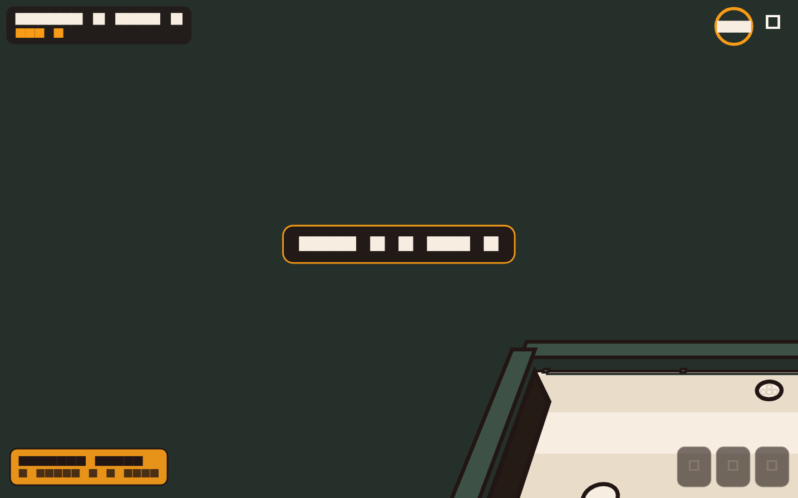
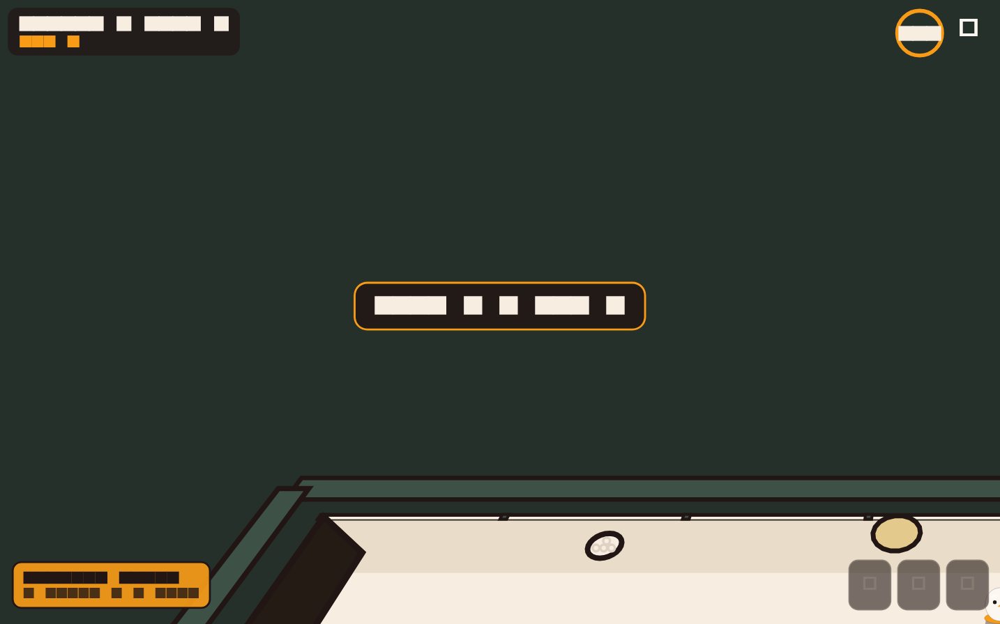

# Sunny Side Putt

The first call activity: a minigolf whose balls are EGGS and whose
holes are NESTS, on a farm, with power-ups. Inspired by Discord's Putt
Party — the numbers follow it; the identity is the Rooster's own.

In play:

A short gameplay clip (aim, roll, the Rabbit Hole trick, the
scoreboard):

[putt-sunny-side-putt-3d.mp4](images/sunny-side-putt/putt-sunny-side-putt-3d.mp4)

## The game

- A course is 6 holes; a match seats 1-8 players (the ninth onward
  watches from the fence). Strokes are simultaneous: everyone lines up
  their putt when they like, and the hole ends when every egg is in or
  the 2-minute clock runs out (warning sounds on the last fifteen
  seconds).
- Out of time: the hole scores max(strokes taken, par + 2). Putt
  Party's exact rule is not documented anywhere we could verify; this
  is ours, and it punishes stalling without ending a comeback.
- Aiming is a slingshot drag with a small wobble on the arrow - the
  Hawk Eye power-up steadies it.
- Mid-join: entering now puts you on the current hole's tee; the holes
  you missed score par.

### Modes

- **Casual** - one course, then the group votes the next.
- **Tournament** - 3, 6 or 9 drawn courses; the scores add up and
  power-ups travel with you.
- **Barnyard Chaos** - casual, but everyone starts with two random
  power-ups and the mystery boxes come doubled.

### Power-ups

Earned at the "?" boxes (a maximum of 3 in hand; extras discarded), and
**the one who casts never suffers their own bad effects** - the wind
spares their egg, the sprinkler waters around it.

| Power-up | Does |
|---|---|
| Hawk Eye | removes the aim wobble on your next shot |
| Nest Magnet | the egg is drawn home when it nears the nest |
| Ghost Egg | passes through fences and obstacles briefly |
| Chicken Hop | your next putt flies over whatever is in the way |
| Rabbit Hole | teleports your egg a short way, costing no stroke |
| Gust | a wind of your choosing pushes every egg but yours |
| Thick Shell | shield: the next negative effect bounces off |
| Strong Coffee | your next shot leaves 30% harder |
| Nest Swap | trade places with a chosen player's egg |
| Sprinkler | mark a spot; nearby eggs are pushed away |
| Corn Rain | kernels bounce around, nudging every egg but yours |
| Thieving Crow | steal a power-up from a chosen player |

### Courses

Five launch courses, six holes each, themselves teaching their
gimmicks: the Coop (a hen walks the floor and bumps eggs), the Corn
Maze (rabbit holes as speed-preserving portals), the Pond (water
returns the egg, stroke charged), Farm Road (speed strips) and the
Barn (hay bales, the silo's pull).

## The layers

- `core/` (pure Dart, headless-testable): deterministic physics with
  fixed timestep and swept collision, the hole model (walls, sensors,
  the wandering hen), the rules engine (phases, clocks, scoring,
  mid-join, snapshot round-trips for host handoff) and the power-up
  contracts.
- `courses/` - the five launch courses, each hole shipped with a
  reference solution that a test replays, so an unfinishable hole
  cannot land.
- `ui/organisms/sunny_side_putt/` - the Flame view: 3D perspective
  camera (orbit/drag, zoom), the farm rendered in layers (ground,
  fences, obstacles, actors with ground shadows), the aim arrow on the
  turf, HUD (scorecard, timer ring pulsing on the last seconds,
  power-up hand), pause/settings/vote menus, spectator strip, and the
  audio (synthesized SFX and a looping tune; volume per bus in the
  settings).
- `putt_session.dart` - the live-session bridge: the host's engine is
  the truth; guests feed their own engine with the accepted-move
  journal and resnapshot, so play is smooth without a game server.

## Testing

- `flutter test unit_test/sunny_side_putt` - physics, rules, every
  power-up, every hole's reference solution, the session bridge (two
  clients on the in-memory wire), the view widgets.
- The voice e2e plays a hole between two real clients; see
  call-activities.md for the environment.
